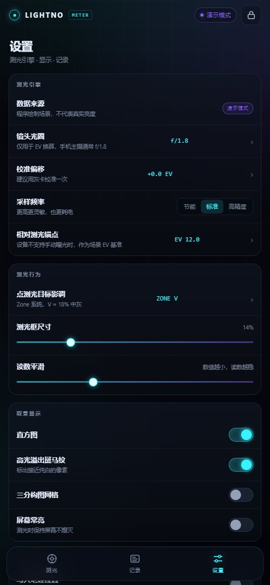

# LIGHTNO · 移动测光表

> 一个为摄影现场准备的网页测光表：点测光、区域框选、平均 / 高光 / 暗部测光，ND 补偿，带参数照片的测光日志。纯静态、零依赖、可离线安装，也能直接内嵌进 App。

<p align="center">
  
  
  
</p>

LIGHTNO 不是「滤镜猜曝光」：它会接管相机的真实曝光参数，把画面解码到线性光后按 18% 中灰反推场景 EV，并按你的相机参数给出可以直接使用的快门速度。

---

## 功能

### 六种测光模式

| 模式 | 行为 |
| --- | --- |
| **点测光** | 圆形测光区，可拖动、可缩放；默认把被测亮度放在 ZONE V（中灰），可改为 ZONE III–VIII |
| **区域框选** | 方形区域平均，适合大面积中间调 / 灰卡 |
| **中央重点** | 高斯加权，越靠画面中心权重越高 |
| **平均测光** | 整幅画面等权平均 |
| **高光优先** | 取画面 98 百分位亮度放到 ZONE VIII，保护高光 |
| **暗部优先** | 取画面 2 百分位亮度放到 ZONE III，保留暗部 |

### 取景与取景框

- 空白处点按：测光框立即移到该点；拖动：移动测光框；右下角手柄：调整大小
- 双指捏合 / 右侧滑杆：变焦（优先硬件变焦，不支持时自动数码变焦，测光采样同步裁切）
- 顶部 HUD：模式、变焦、锁定、演示标记 + 实时直方图（log2 亮度 + 中灰刻度 + 溢出提示）
- 高光溢出斑马纹、三分构图网格、屏幕常亮
- 双击画面 / 右上角锁按钮：锁定测光，方便锁定后重新构图

### 读数与曝光

- 大号 **EV100**、场景亮度（cd/m²）、反差（EV 档）、色温估算、ZONE
- ISO / 光圈 / 快门 / ND 四个曝光单元：**上下滑动 / 鼠标滚轮 / 键盘 ↑↓** 切换，滑动时浮层显示**相邻档位**，点按打开选择器
- **曝光优先**：调光圈 → 测光决定快门（光圈优先）；调快门 → 测光决定光圈（快门优先），自动值带 `AUTO` 标记
- **等效曝光阶梯**：同一 EV 下相邻光圈的快门组合，点一下即切换
- 推荐快门按 1/3 档取整，同时给出精确值；超出范围会以琥珀色提示

### ND 减光镜

选择 ND2 / ND4 / ND8 / ND16 / ND32 / ND64 / ND128 / ND256 / ND512 / ND1000，或自定义 0–15 档（1/3 档步进）。

ND 只改变推荐曝光，不改变场景 EV：

```
t' = t × 2^ND档数        // 光圈优先：延长快门
```

例：EV 12、f/8、ISO 100 → 基准快门 1/64s；装 **ND16（4 档）** 后直接使用 **1/4s**。界面会同时显示基准快门与最终快门。

**快门优先**时快门由你固定，ND 由光圈补偿（例如 1/4s + ND16 会得到 f/8 的光圈解）。

### 曝光优先与拨盘

四个曝光单元都是「拨盘」：

- 手机：在单元上**上下滑动**
- 桌面：鼠标滚轮，或聚焦后按 **↑ / ↓**
- 点按单元：打开大号选择器（ISO / 光圈 / 快门 / ND）
- 滑动时会浮出**档位拨盘**：中间是当前值，上下显示相邻档位（类似相机拨轮 / iOS 滚轮）

规则：

| 操作 | 结果 |
| --- | --- |
| 调**光圈** | 进入**光圈优先**，测光自动计算快门 |
| 调**快门** | 进入**快门优先**，测光自动计算光圈 |
| 调 ISO / ND | 保持当前优先模式，曝光随之更新 |

自动值会显示 `AUTO` 标记；手动值显示「手动设定」。也可以在「测光选项 → 曝光优先」里显式切换，切换时会用当前读数保持曝光不变。光圈优先时 ND 延长快门；快门优先时 ND 由光圈补偿。

### 测光日志

- 点取景框下方的保存键：拍下当前画面，并烧录 EV、模式、ISO、光圈、快门、ND、亮度、反差、色温、测光框位置、时间、坐标（可选）
- 记录以 **Blob + IndexedDB** 存在本机，缩略图列表、详情、备注、收藏、单张下载
- 支持 **JSON 备份导出 / 导入**（含照片的 base64），换机或清缓存前请先导出
- 记录页支持全部 / 今天 / 本周 / 收藏筛选

### 校准与引擎自检

- **硬件测光**：在支持 `MediaStreamTrack` 手动曝光的设备上接管相机曝光，输出绝对 EV
- **相对测光**：不支持手动曝光的浏览器自动降级，用「场景锚点 EV + 相对亮度」计算
- **校准向导**：对准 18% 灰卡，输入参考 EV（来自灰卡标准光照或另一台测光表），把系统偏差写入本机
- 点顶部状态胶囊可查看当前引擎能力（曝光范围、ISO 范围、变焦范围、校准值）

### 离线 / 安装 / 内嵌

- Service Worker 预缓存全部静态资源，断网可用；数据不依赖网络
- PWA 可安装到主屏幕（Android / iOS / 桌面）
- 纯静态、相对路径，可直接部署到 GitHub Pages 子路径
- 可被 Capacitor / Cordova / WebView 内嵌（见下文）

---

## 快速开始

```bash
npm start          # 启动本地静态服务器 → http://localhost:5173
npm test           # 曝光数学 + 亮度统计 + 数据层测试
npm run verify     # JS 语法 / DOM id / 静态资源 / manifest / SW 校验
```

> **必须通过 `https://` 或 `http://localhost` 打开。** 浏览器的相机与 Service Worker 都要求安全上下文，直接双击 `index.html`（`file://`）无法工作。

没有相机时可以在桌面预览：

```
http://localhost:5173/?demo=1
```

### 调试 / 演示参数

| 参数 | 作用 |
| --- | --- |
| `?demo=1` | 进入演示模式：程序绘制风景，不需要相机，可直接体验测光与保存 |
| `?skipintro=1` | 跳过首次引导 |
| `#log` / `#settings` | 直接打开记录 / 设置页 |

---

## 测光原理（以及它为什么会准 / 会不准）

### 1. 数据来源

手机浏览器**不会**把镜头的物理光圈、真实快门直接告诉网页。LIGHTNO 用两条路径解决：

**A. 硬件测光（推荐）**

在支持 `MediaStreamTrack.getCapabilities()` 手动曝光的设备（多数 Android Chrome）上：

1. 接管相机的 `exposureTime` 与 `iso`（`exposureMode = manual`）；
2. 自动调整相机曝光，把测光区压到中灰附近，避免高光 / 暗部溢出；
3. 用「已知的相机曝光 + 画面线性亮度」反推场景 EV。

公式（`N` = 设置中的镜头光圈，`t` = 相机快门，`S` = 相机 ISO，`L` = 测光区线性亮度，0.18 = 18% 中灰）：

```
EV100 = log2(N² / t) − log2(S / 100) + log2(L / 0.18) + 校准
```

相机自动曝光目标取 `L ≈ 0.18`，因此读数主要由 `t / S` 决定，画面亮度只用于修正区域差异。这正是反射式测光表的做法。

**B. 相对测光（自动降级）**

iOS Safari 等浏览器不开放 `exposureTime`，网页无法知道相机用了多少快门。此时：

```
EV100 = 锚点EV + log2(L / 0.18) + 校准
```

锚点 EV 由你设置（来自另一台测光表、晴天 16 法则或已知光照）。相机自动曝光会让画面平均亮度保持在中灰附近，因此**点 / 区域之间的相对亮度差仍然可靠**，但绝对 EV 依赖锚点。界面会明确标注「相对测光」，不会假装准确。

> 这也是为什么同样的网页在 Android 与 iPhone 上读数来源不同。想获得绝对读数，优先使用支持手动曝光的浏览器；或在 App 内嵌时通过原生插件提供真实曝光参数。

### 2. 画面亮度

1. `canvas.drawImage` 按取景框比例裁切（含数码变焦），缩放到 256–320px；
2. 用 sRGB EOTF LUT 把像素解码为**线性光**；
3. 计算 Rec.709 亮度 `Y = 0.2126R + 0.7152G + 0.0722B`；
4. 用 log2 亮度直方图（128 bin）统计均值、2/10/50/90/98 百分位、溢出比例；
5. 按模式对区域加权（圆形羽化 / 方形 / 高斯 / 全画面）。

### 3. 测光模式与 Zone

Zone 系统里 ZONE V = 18% 中灰，每 Zone 相差 1 EV。点测光把被测区域放到你选的目标影调：

```
EV推荐 = EV区域 − (目标Zone − 5)
```

- 高光优先：`EV = EV(p98) − 3`（放到 ZONE VIII）
- 暗部优先：`EV = EV(p02) + 2`（放到 ZONE III）

### 4. 推荐快门

光圈优先（默认，光圈由你设定）：

```
EV_S = EV100 + log2(S/100)
t    = N² / 2^(EV_S − ND档数)
```

快门优先（快门由你设定，光圈由测光反解）：

```
N = √( t × 2^(EV100 + log2(S/100) − ND档数) )
```

结果按相机常见的 1/3 档序列取整显示，同时保留精确值；超出常见档位时显示精确值并提示。

### 5. 校准

不同手机预览的色调曲线、镜头光圈、传感器响应都不同。校准的数学很简单：

```
新偏移 = 旧偏移 + (参考EV − 当前读数)
```

校准值范围 ±6 EV，只保存在本机。一次校准长期有效（除非你改了镜头光圈或系统相机行为）。

**建议流程**：对准 18% 灰卡（充满测光框）→ 用另一台测光表 / 标准光照得到 EV → 校准向导输入参考值 → 应用。没有灰卡时，也可以在均匀阴天对着柏油路 / 中灰墙面粗略校准。

### 6. 精度预期

- 硬件测光 + 校准后：**±1/3 EV 以内**是合理目标
- 未校准：通常有 ±0.5–1 EV 的机型差异
- 相对测光：绝对精度取决于锚点，区域内相对关系准确
- 极暗环境：手机预览噪声 / 增益会破坏线性，读数仅供参考
- 色温为整幅画面平均值估算（受相机自动白平衡影响），不是专业色温表

---

## 使用指南

### 第一次使用

1. 允许相机权限；
2. 看「设置 → 数据来源」：显示「手动曝光」说明是硬件测光；显示「相对测光」则先设置锚点 EV；
3. 用灰卡做一次校准；
4. 回到测光页，拖动圆框对准主体。

### 现场测光

1. 选测光模式：人像测脸部用**点测光**；大面积中间调用**区域框选**；逆光保护高光用**高光优先**；
2. 点按 / 拖动测光框；需要更近的局部时双指放大；
3. 看 EV 与推荐曝光；上下滑动**光圈**进入光圈优先（自动改快门），滑动**快门**进入快门优先（自动改光圈）；
4. 双击画面锁定读数，重新构图；
5. 按取景框下方的保存键存档。

### ND 长曝光

1. 在曝光栏点 ND，选择你实际安装的减光镜；
2. 推荐快门自动变成「装 ND 后可直接使用」的值；
3. 超过 60s 会以秒 / 分钟显示，配合三脚架与快门线使用。

### 记录与备份

- 「记录」页点任意条目查看带参数照片、添加备注、收藏、下载
---

## 部署到 GitHub Pages

项目没有构建步骤，所有路径都是相对路径（`./`），可以直接放在仓库根目录或任意子目录。

```bash
git init
git add .
git commit -m "LIGHTNO light meter"
git branch -M main
git remote add origin git@github.com:<你的用户名>/lightno.git
git push -u origin main
```

然后在 GitHub 仓库：

1. **Settings → Pages**
2. Source 选 **Deploy from a branch**
3. Branch 选 **main**，目录选 **/ (root)**
4. 保存后访问 `https://<你的用户名>.github.io/lightno/`

### 更新版本时

修改任何前端文件后，请把 `sw.js` 顶部的版本号加一：

```js
const VERSION = 'lightno-v1.0.1';
```

Service Worker 会建立新缓存、清理旧缓存，并在页面上弹出「LIGHTNO 有新版本 → 刷新」。如果不改版本号，已安装的用户可能继续使用旧缓存。

> 自定义域名、HTTPS、子路径部署都不需要额外配置。GitHub Pages 默认 HTTPS，满足相机与 Service Worker 的安全上下文要求。

---

## 安装与离线

- **Android Chrome**：菜单 →「安装应用 / 添加到主屏幕」
- **iOS Safari**：分享 →「添加到主屏幕」  
  建议先在 Safari 标签页里完成一次相机授权，再添加到主屏幕。
- **桌面 Chrome / Edge**：地址栏右侧安装图标，或设置页「安装到桌面」

首次成功加载后，Service Worker 会缓存全部 HTML / CSS / JS / 图标。之后断网仍然可以：

- 启动应用与进入演示模式
- 使用相机测光（不依赖网络）
- 保存、浏览、备注、导出测光记录

**不会离线**的部分：无（应用没有后端）。

记录保存在浏览器的 IndexedDB 中。系统在存储空间不足或用户清理站点数据时可能清除它，请定期导出 JSON 备份。

---

## 内嵌到 App（WebView / Capacitor / Cordova）

LIGHTNO 是纯静态站点，可以直接作为 App 的本地页面使用。要点：

### 1. 必须通过安全上下文加载

`getUserMedia` 与 Service Worker 需要 `https://`、`http://localhost` 或平台认可的本地 scheme。**不要用 `file://` 直接加载**，否则相机与离线缓存都不可用。

推荐做法：

- **Capacitor**：把静态文件放进 `www/`，使用内置本地服务器（Android 为 `https://localhost`，iOS 为 `capacitor://localhost`）
- **Cordova**：`cordova-plugin-ionic-webview` 提供的 `https://localhost`
- **自建 WebView**：用 `WebViewAssetLoader`（Android）或本地 HTTP 服务加载

### 2. 权限声明

- **Android**：`AndroidManifest.xml` 增加
  ```xml
  <uses-permission android:name="android.permission.CAMERA" />
  ```
  WebView 还需处理 `onPermissionRequest`（授予 `RESOURCE_VIDEO_CAPTURE`）。
- **iOS**：`Info.plist` 增加
  ```xml
  <key>NSCameraUsageDescription</key>
  <string>用于摄影测光</string>
  ```
  WKWebView 需要 `allowsInlineMediaPlayback = true`，并允许自动播放（`mediaTypesRequiringUserActionForPlayback = []`）。

### 3. Capacitor 示例

```bash
npm i -D @capacitor/cli
npx cap init LIGHTNO com.example.lightno --web-dir=www
npx cap add android
npx cap add ios
npx cap sync
npx cap open android   # 或 ios
```

`capacitor.config.json`：

```json
{
  "appId": "com.example.lightno",
  "appName": "LIGHTNO",
  "webDir": "www",
  "server": {
    "androidScheme": "https"
  },
  "android": {
    "allowMixedContent": false
  }
}
```

UI 已经处理了安全区、`100dvh`、横屏与触控手势，WebView 内不需要额外适配。

### 4. 离线策略

App 内嵌时静态文件本来就打包在安装包里，Service Worker 属于锦上添花。如果 WebView 不支持 SW（例如自定义 `file://` 加载），**核心测光与 IndexedDB 记录仍然可用**，只是无法安装为 PWA。

### 5. 想要更准的 iOS 读数？

网页在 iOS 上拿不到 `exposureTime`。如果这个 App 主要面向 iPhone，建议用原生插件读取 `AVCaptureDevice` 的曝光参数，再通过 `evaluateJavascript` 把「当前相机快门 / ISO / 光圈」注入页面，替换 `currentExposure()` 的数据来源即可。测光数学、UI、记录层都不需要改。

---

## 浏览器兼容与已知限制

| 平台 / 浏览器 | 相机手动曝光 | LIGHTNO 行为 |
| --- | --- | --- |
| Android Chrome 80+ | 多数机型支持 | **硬件测光**（绝对 EV） |
| iOS / iPadOS Safari 15+ | 不支持 `exposureTime` | 相对测光 + 锚点 |
| 桌面 Chrome / Edge | USB 摄像头有时支持 | 自动判断 |
| Firefox / 其他 | 约束支持有限 | 多为相对测光 |

### 限制（请务必了解）

1. **只有反射式测光**：没有入射式测光球，也没有闪光测光。
2. **镜头光圈由你设置**：网页读不到物理光圈，默认 f/1.8 只用于换算，校准会吸收误差。
3. **预览不是 RAW**：手机相机的预览有色调曲线与降噪，极暗 / 极亮时会偏离线性。
4. **色温是估算**：基于整幅画面平均 RGB 的 McCamy 近似，并受自动白平衡影响。
5. **相机曝光有物理极限**：AE 循环会在快门 / ISO 范围内收敛，超出范围时读数仍可计算，但预览可能溢出。
6. **无头浏览器 / 隐私模式**：部分环境会禁用 IndexedDB，应用会提示「本地数据库打开超时」，此时仍可测光，但无法保存记录。
7. **不替代专业测光表**：用于快速估光、外拍参考、胶片 / 大画幅的现场记录；商业拍摄请以校准后的专业设备为准。

---

## 项目结构

```
.
├── index.html                  # 单页应用骨架（测光 / 记录 / 设置）
├── manifest.webmanifest        # PWA 清单
├── sw.js                       # Service Worker（离线缓存，改版本号）
├── server.mjs                  # 零依赖本地静态服务器（npm start）
├── css/
│   ├── theme.css               # 设计令牌、基础样式、动效
│   ├── layout.css              # App 骨架、取景台、抽屉、响应式
│   └── components.css          # 按钮、读数、曝光单元、列表、Toast…
├── js/
│   ├── main.js                 # 入口：视图路由、引导、相机生命周期
│   ├── pwa.js                  # SW 注册、安装提示、离线状态
│   ├── core/
│   │   ├── exposure.js         # EV / ND / Zone / 色温 / 格式化（纯函数）
│   │   ├── sampler.js          # 线性亮度、区域统计、直方图、溢出图
│   │   ├── camera.js           # getUserMedia、手动曝光、变焦
│   │   ├── state.js            # 设置持久化 + 运行时状态 + 订阅
│   │   ├── store.js            # IndexedDB 测光记录仓库（带超时）
│   │   ├── capture.js          # 带参数照片合成（Canvas）
│   │   ├── demo.js             # 程序绘制的演示场景
│   │   └── wake.js             # 屏幕常亮
│   └── ui/
│       ├── meter.js            # 测光主控：采样、AE、读数、保存
│       ├── gestures.js         # 拖动 / 缩放 / 捏合手势
│       ├── pickers.js          # ISO / 光圈 / ND / Zone / 校准 / 说明
│       ├── history.js          # 记录列表、详情、备份导入导出
│       ├── settings.js         # 设置页
│       ├── sheet.js            # 底部抽屉
│       ├── toast.js            # 提示
│       ├── haptic.js           # 触感反馈
│       └── dom.js              # DOM / 格式化工具
├── assets/icons/               # PWA 图标（tools/make-icons.mjs 生成）
├── tools/
│   ├── make-icons.mjs          # 纯 Node PNG 图标生成器
│   └── verify.mjs              # 静态校验
└── tests/
    ├── run.mjs                 # 曝光数学 + 测光统计
    ├── store.test.mjs          # 数据层（内存版 IndexedDB）
    └── fake-idb.mjs            # 测试替身
```

---

## 测试与校验

```bash
npm test        # 18 个曝光 / 统计断言 + 5 个数据层断言
npm run verify  # 21 个 JS 文件语法、98 个 DOM id、静态资源、SW 预缓存、manifest
npm run icons   # 重新生成 180 / 192 / 512 / maskable 图标
```

`tools/verify.mjs` 会检查：

- 所有 JS 能否按 ES Module 解析
- `$('#id')` / `getElementById` 引用的 DOM 节点是否在 HTML 或 JS 模板里存在
- `index.html` 引用的本地文件是否存在
- `sw.js` 预缓存列表中的文件是否存在
- `manifest.webmanifest` 是否为合法 JSON、图标是否存在

> 本机无头 Edge 会禁用 IndexedDB，因此自动化截图环境下「记录」页会显示超时提示；真实浏览器不受影响，数据层已用内存替身单独测试。

---

## 数据与隐私

- 相机画面只在内存中处理，**不上传**
- 测光照片与参数写入本机 IndexedDB；设置写入 localStorage
- 地理位置是可选开关，只在保存时请求一次，写入该条记录
- 没有账号、没有统计 SDK、没有外部字体 / CDN
- 导出备份由你手动触发，文件留在本机

---

## Roadmap

- [ ] iOS / Android 原生插件：读取真实 `exposureTime` / ISO / 光圈，获得 iOS 绝对测光
- [ ] 入射式测光（白球 / 灰卡辅助）
- [ ] 闪光测光（声控 / 屏幕同步）
- [ ] 胶片 reciprocity 补偿表
- [ ] 多点测光 / 场景动态范围图
- [ ] CSV 导出与拍摄参数对比
- [ ] 专业色温 / Tint 读数

---

## License

MIT